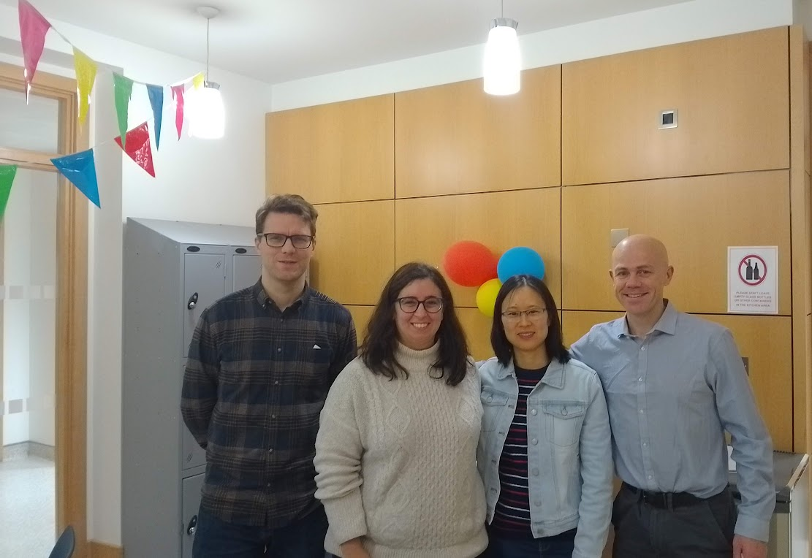

**Congratulations to Jinbo Zhao on passing her PhD viva-voce examination!**

Jinbo successfully defended her thesis, *"Statistical Genetics Models with Actuarial Applications"*, before external examiner Dr. Peter Joshi and internal examiner Prof. Thomas Brendan Murphy, passing with minor corrections.

Many thanks to Dr. Adrian O'Hagan for co-supervising Jinbo throughout her PhD, and to Dr. Isabella Gollini for chairing the examination.

